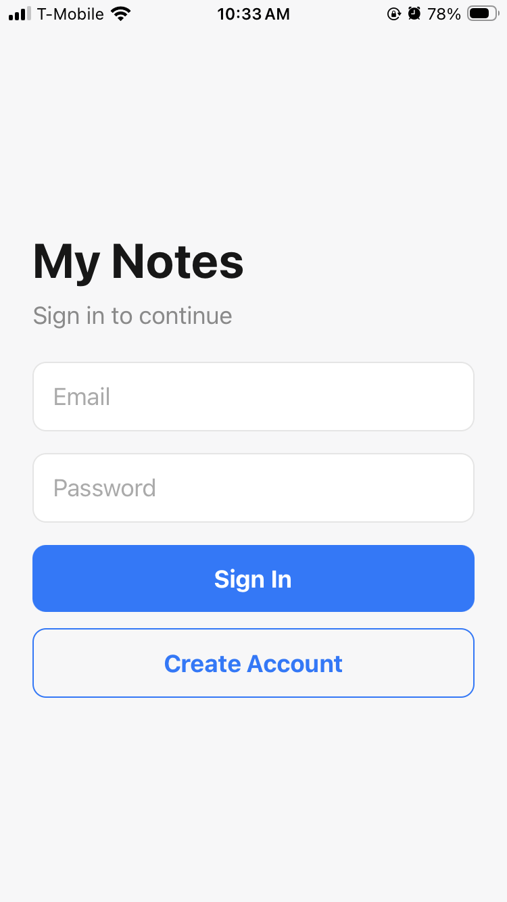
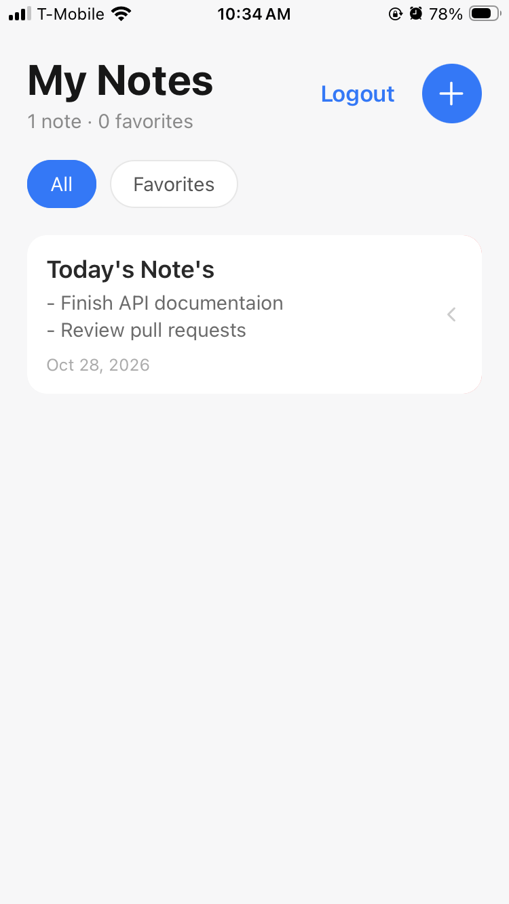
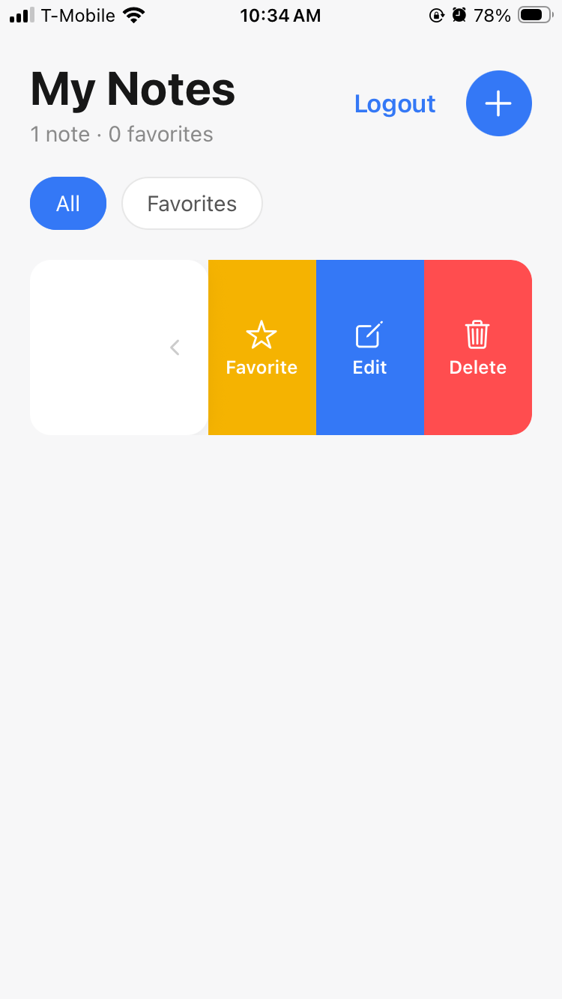
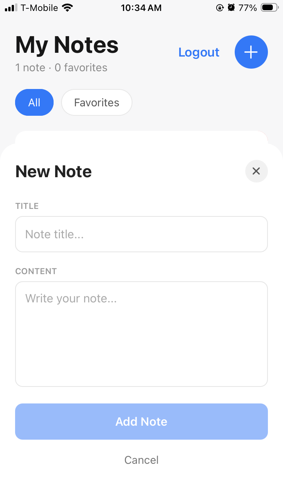

# My Notes

A personal notes app built with Expo, Expo Router, Firebase Authentication and Cloud Firestore.

## Screenshots

<p>
  
  
  
  
</p>

## Features

- Email/password sign up, login and logout
- Notes (title, content, type, creation date) stored in Firestore, visible only to their owner
- Categorize notes as School, Work, Personal, or a custom type
- Create, edit and delete notes (delete asks for confirmation)
- Mark notes as favorites and filter between All / Favorites
- Total note count in the header

## Setup

1. Install dependencies: `npm install`
2. In the Firebase console, enable **Authentication → Email/Password** and create a **Firestore** database.
3. Copy `.env.example` to `.env.local` and fill in your Firebase web app config (never commit `.env.local`).
4. Paste these rules into **Firestore → Rules**:

   ```
   rules_version = '2';
   service cloud.firestore {
     match /databases/{database}/documents {
       match /notes/{noteId} {
         allow create: if request.auth != null
                       && request.resource.data.userId == request.auth.uid;
         allow read, update, delete: if request.auth != null
                       && resource.data.userId == request.auth.uid;
       }
     }
   }
   ```

5. Start the app: `npx expo start`

## Data model (`notes` collection)

| Field       | Type      |
| ----------- | --------- |
| `title`     | string    |
| `content`   | string    |
| `type`      | string    |
| `favorite`  | boolean   |
| `createdAt` | timestamp |
| `userId`    | string    |
